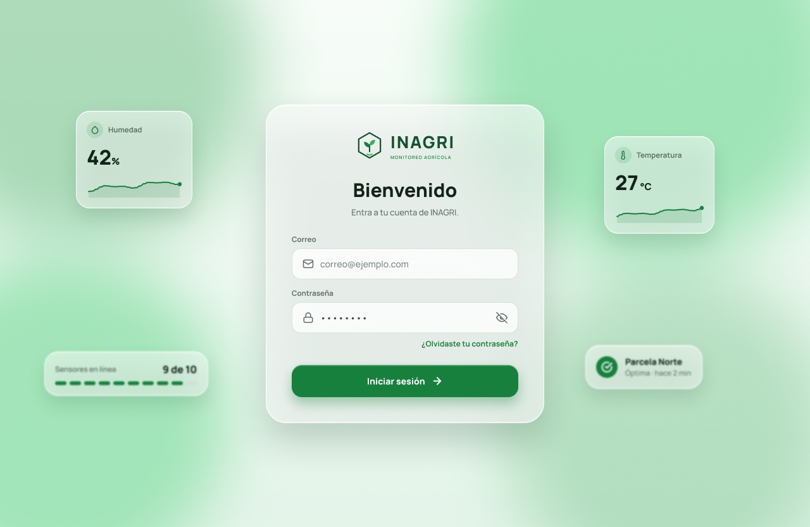
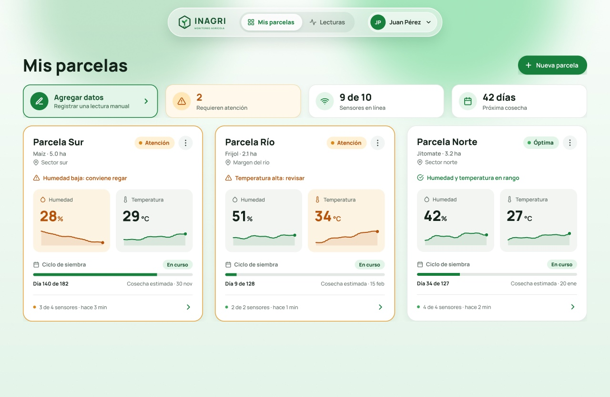
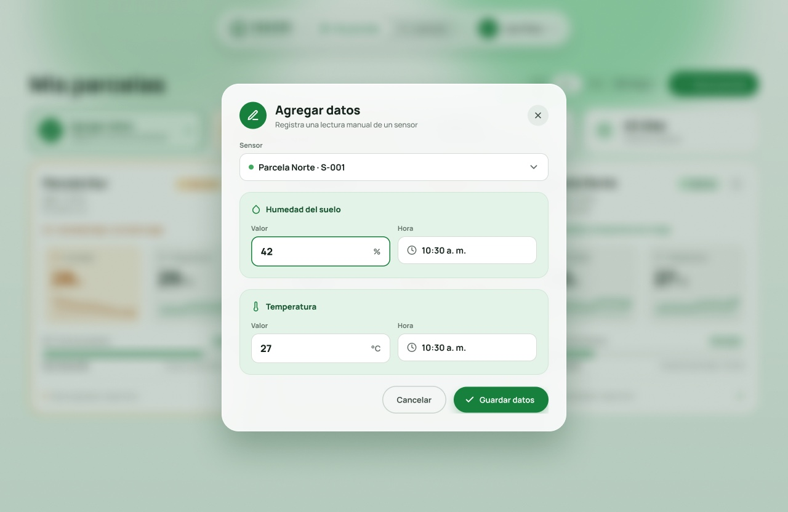
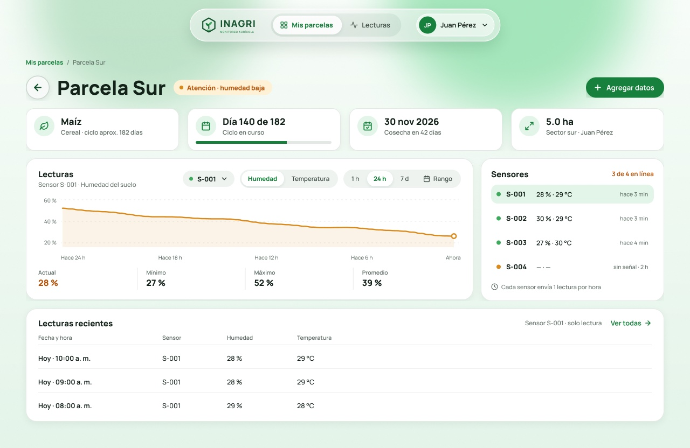
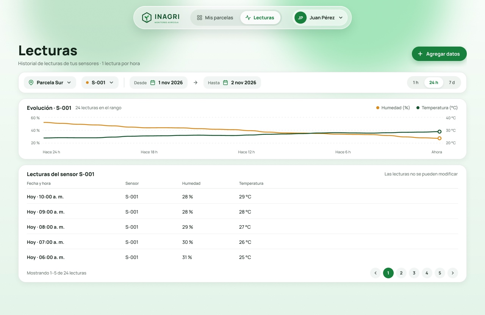
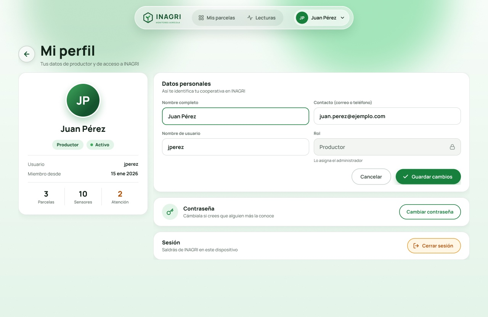

# INAGRI
Sistema en la nube para una cooperativa agrícola que mide la humedad y la temperatura en sus parcelas. Su objetivo es que los productores y los administradores puedan registrar las lecturas de los sensores y consultarlas de forma rápida y ordenada.

## Diseños de la interfaz

Pantallas principales del prototipo en Figma. Las 25 pantallas, con todos sus estados, están en [docs/disenos](docs/disenos/README.md).

| | |
|---|---|
| **Iniciar sesión**  | **Mis parcelas**  |
| **Agregar datos**  | **Detalle de parcela**  |
| **Lecturas**  | **Mi perfil**  |
